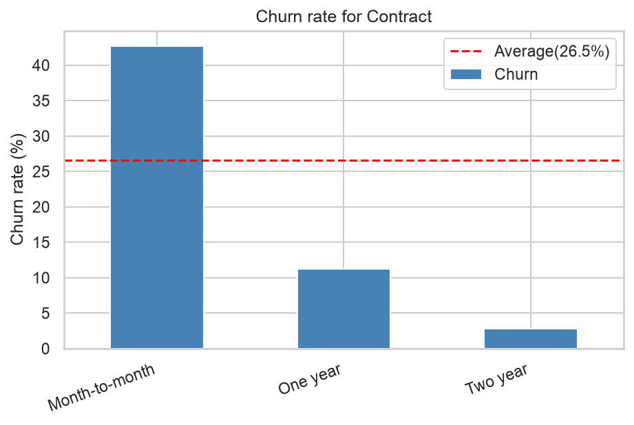
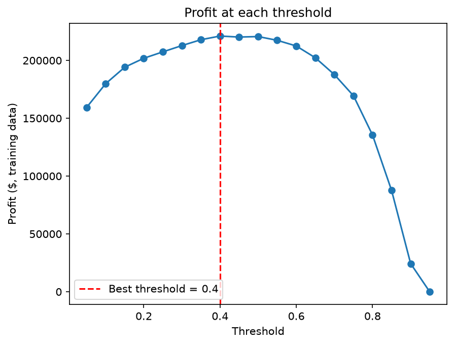
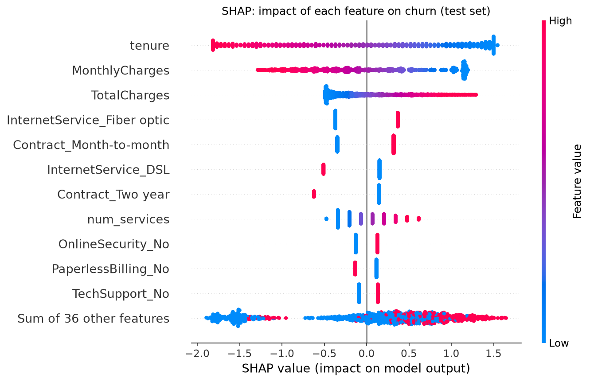

# 📉 Customer Churn Prediction

Predicts which telecom customers are about to leave, explains **why**, and picks who to contact to **maximize profit**. Estimated value: **~$260K per year** vs doing nothing, and almost **2× more** than contacting every customer.

**🔗 Live demo:** _coming soon_



## The problem

A telecom company loses **26.5%** of its customers. Churned customers made up **$139K per month (~$1.67M per year)**, which is **30.5% of revenue**: the company is losing its higher-paying customers. The goal is to find at-risk customers early so the retention team can make them an offer.

## Results

| | Value |
|---|---|
| Model | Logistic Regression (class-balanced) |
| Test ROC-AUC | **0.842** (cross-validation: 0.846, so no overfitting) |
| Churners caught (recall) | **86.6%** (324 of 374 on the test set) |
| Decision threshold | **0.40**, chosen for maximum profit, not the default 0.5 |

**Business value on the test set (1,409 customers):**

| Strategy | Profit |
|---|---|
| Do nothing | $0 |
| Contact every customer | $27,524 |
| **This model** | **$52,010** |
| Perfect model (upper limit) | $79,274 |

Assumptions: a retention offer costs $50, 30% of contacted churners stay, and a saved customer stays 12 more months.

## Key insights

- **New customers are the biggest risk:** 52.9% churn in the first 6 months vs 9.5% after 4 years.
- **Month-to-month contracts** churn at 42.7% vs 2.8% for two-year contracts.
- **Fiber optic** customers churn at 41.9%, despite it being the premium service. Worth investigating price or quality.
- **Electronic check** payers churn at 45.3% vs ~15% for automatic payments.

| Profit at each threshold | What drives churn (SHAP) |
|---|---|
|  |  |

## Approach

1. **[Data cleaning](notebooks/01_data_cleaning.ipynb):** found 11 blank `TotalCharges` values, all for brand-new customers (tenure 0), and filled them with 0 instead of the mean.
2. **[EDA](notebooks/02_eda.ipynb):** churn rate by segment, tenure and charges, and the revenue lost to churn.
3. **[Modeling](notebooks/03_modeling.ipynb):**
   - Stratified 80/20 split; preprocessing inside a scikit-learn `Pipeline` to prevent data leakage
   - Compared a baseline, logistic regression, Random Forest and XGBoost with 5-fold cross-validation
   - Default tree models overfit (train AUC 1.00 vs 0.82 validation). Once tuned they **matched but did not beat** logistic regression, so I kept the simpler model.
   - Chose the threshold that maximizes profit on cross-validation, then opened the test set once.
4. **[Explainability](notebooks/04_explainability.ipynb):** coefficients and SHAP, globally and for single customers.
5. **[Streamlit app](app/app.py):** enter a customer, get their churn probability, a recommended action, and the top reasons.

| Model (5-fold CV) | Recall | ROC-AUC |
|---|---|---|
| Baseline (always "stay") | 0.000 | 0.500 |
| Logistic Regression | 0.543 | 0.846 |
| **Logistic Regression (balanced)** | **0.801** | **0.846** |
| Random Forest (tuned) | 0.782 | 0.847 |
| XGBoost (tuned) | 0.797 | 0.846 |

## Project structure

```
├── app/app.py           # Streamlit app
├── data/                # raw and cleaned data
├── images/              # charts used in this README
├── models/              # saved pipeline + threshold
├── notebooks/           # 01 cleaning → 02 EDA → 03 modeling → 04 explainability
└── requirements.txt
```

## How to run

```bash
git clone https://github.com/omshivbhosale/Customer-Churn-Prediction.git
cd Customer-Churn-Prediction
python -m venv .venv
source .venv/bin/activate
pip install -r requirements.txt
streamlit run app/app.py
```

## Limitations and next steps

- Business assumptions ($50 offer, 30% success) are estimates. With real campaign data, the threshold can be re-tuned. For example, at $100 per offer the best threshold rises to about 0.65.
- The dataset is a single snapshot. A real system would retrain regularly and monitor for drift.
- Next: A/B test the retention offers to measure the real success rate.

**Data:** [IBM Telco Customer Churn](https://www.kaggle.com/datasets/blastchar/telco-customer-churn) (7,043 customers).
